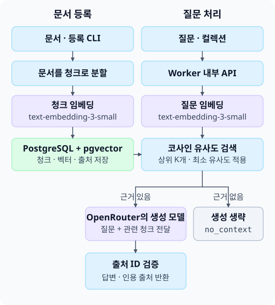

## RAG란?

RAG(Retrieval-Augmented Generation, 검색 증강 생성)는 **질문과 관련된 자료를 검색한 뒤, 그 자료를 참고해 답변을 생성하는 방식**입니다. 사용자가 질문하면 시스템은 사내 위키나 제품 매뉴얼 같은 자료에서 관련 내용을 찾습니다. 언어 모델은 질문과 검색 결과를 함께 받아 답변을 작성합니다. [Lewis 외, 2020](https://arxiv.org/abs/2005.11401)

예를 들어 사내 챗봇에 “재택근무는 어떻게 신청해요?”라고 물어봅시다. 시스템은 사내 위키에서 재택근무 지침을 검색하고, 신청 경로와 승인 절차가 담긴 문단을 모델에 전달합니다. 모델은 그 문단을 읽고 신청 절차를 안내합니다. 검색은 답변에 필요한 자료를 찾는 단계이고, 생성은 그 자료를 바탕으로 질문에 맞는 답변을 작성하는 단계입니다.

이렇게 하면 모델을 다시 학습시키지 않고도 사내 문서의 내용을 답변에 활용할 수 있습니다. 다만 검색 결과에 오래된 지침이 포함되거나 필요한 조항이 빠지면 답변도 틀릴 수 있습니다.

## 왜 RAG를 쓸까?

재택근무 지침이 바뀌면 챗봇은 개정된 지침을 기준으로 답해야 합니다. RAG에서는 문서가 바뀔 때 검색 인덱스를 갱신하면 이후 요청에서 새 지침을 가져올 수 있습니다. 검색 결과에 문서 제목과 링크를 함께 보관하면 사용자가 답변의 근거를 직접 확인할 수도 있습니다.

사내 위키에 문서가 수천 개 있어도 재택근무 신청 절차를 안내하는 데 필요한 내용은 몇 문단일 수 있습니다. RAG는 질문마다 관련 문단만 모델에 보내 입력 토큰을 줄일 수 있습니다. 그만큼 문서를 검색할 수 있도록 관리하는 작업이 필요하고, 검색 단계에서 예외 조항을 놓치면 답변에도 반영하기 어렵습니다. 실제 비교 연구에서도 긴 문서를 직접 입력하는 방식이 실험의 평균 답변 성능에서 앞섰고, RAG는 비용이 더 낮았습니다. [Li 외, 2024](https://arxiv.org/abs/2407.16833)

## RAG 외에 어떤 방법이 있을까?

### 문서를 프롬프트에 직접 넣기

재택근무 지침처럼 참고할 문서가 정해져 있다면 질문과 함께 문서 전체를 모델에 전달할 수 있습니다. 검색 인덱스를 따로 운영할 필요가 없고, 앞뒤 조항이나 예외 조건을 함께 읽힐 수 있습니다. 자료가 많아지면 모델이 한 번에 읽을 수 있는 분량과 입력 토큰 비용을 고려해야 합니다. [Anthropic의 Contextual Retrieval 문서](https://www.anthropic.com/research/contextual-retrieval)

### API나 데이터베이스에서 직접 조회하기

“내 재택근무 신청이 승인됐나요?”라는 질문의 답은 사내 위키가 아니라 신청 시스템에 있습니다. 애플리케이션에서 신청 상태를 조회하고 그 값을 화면에 표시하거나 정해진 문장으로 안내할 수 있습니다. 조회할 항목과 응답 형식이 명확하면 생성 모델 없이도 처리할 수 있습니다.

### FAQ나 문서 검색 결과 보여주기

“재택근무 신청 페이지가 어디예요?”처럼 링크 하나면 충분한 질문은 FAQ나 검색 결과로 처리할 수 있습니다. 사용자가 원문에서 조건을 확인하기 쉽고 생성 단계도 필요 없습니다. 여러 문서에 흩어진 조건을 종합해야 한다면 사용자가 직접 읽고 비교해야 합니다.

## 챗봇형 LLM이 보편화되기 전에는 AI를 어떻게 썼을까?

Gmail의 스팸 필터처럼, AI는 오래전부터 범위가 정해진 문제에 쓰였습니다. 스팸 필터에 이메일이 들어오면 시스템은 스팸일 가능성을 판단하고, 서비스는 그 결과를 바탕으로 메일을 분류합니다. 이때 AI의 출력은 사용자가 읽을 답변이 아니라 서비스가 다음 동작을 결정하는 데 쓰는 분류 결과입니다. [Google Research의 Gmail 스팸 필터 개발 기록](https://research.google/people/simontong/)

사내 챗봇에도 같은 방식을 적용할 수 있습니다. 문의를 ‘근무 제도’, ‘급여’, ‘계정’으로 나누도록 모델을 학습시키고, 앱은 분류 결과에 따라 담당 부서나 FAQ를 안내합니다. 분류기 하나로 모든 답변을 작성할 필요 없이, 모델의 판단과 서비스의 안내 문구를 각각 관리할 수 있습니다.

자연어 처리에서는 이미 학습된 모델을 여러 작업에 재사용하는 방식도 발전했습니다. 2019년에 발표된 BERT는 대량의 텍스트로 사전 학습한 뒤, 문장 분류나 주어진 글에서 답을 찾는 질의응답 같은 작업에 맞춰 추가 학습할 수 있었습니다. 이렇게 사전 학습한 모델을 특정 작업에 맞게 조정하는 과정을 파인튜닝이라고 합니다. [Devlin 외, 2019](https://aclanthology.org/N19-1423/)

## 파인튜닝이란?

파인튜닝(fine-tuning)은 **사전 학습된 모델의 가중치를 특정 데이터나 작업에 맞춰 추가 학습으로 조정하는 과정**입니다. 그중 지도 파인튜닝(Supervised Fine-Tuning, SFT)은 입력과 기대하는 출력의 쌍을 사용합니다. 앞의 문의 분류기라면 ‘재택근무는 어떻게 신청해요?’라는 입력에 ‘근무 제도’라는 정답을 붙입니다. 생성형 챗봇이라면 같은 질문에 ‘요약 → 절차 → 문의처’ 순서로 작성된 답변을 예시로 제공할 수 있습니다. [Hugging Face의 지도 파인튜닝 문서](https://huggingface.co/docs/trl/sft_trainer)

파인튜닝을 검토할 때는 먼저 프롬프트에 원하는 답변 형식과 예시를 넣고, 학습에 쓰지 않을 질문들로 결과를 확인해 볼 수 있습니다. 답변 형식을 자주 어기거나 특정 유형의 문의를 반복해서 잘못 처리한다면, 그 사례를 모아 파인튜닝한 뒤 같은 평가 질문으로 개선 여부를 확인합니다.

RAG와 파인튜닝은 같은 챗봇에 함께 적용할 수 있습니다. 재택근무 지침에서 현재 신청 절차를 가져오는 일은 RAG가 맡고, 가져온 내용을 팀에서 원하는 형식으로 작성하는 습관은 파인튜닝으로 학습시킬 수 있습니다. 지침이 개정되면 검색 인덱스를 갱신하고, 답변 방식이 바뀌면 프롬프트나 학습 예시를 조정합니다.

## Grow Together의 Vanilla RAG 아키텍처

Grow Together에서는 문서를 미리 등록하는 흐름과 질문을 받을 때 답변을 만드는 흐름을 분리했습니다. 두 흐름은 같은 임베딩 모델을 사용하고, PostgreSQL의 pgvector를 통해 연결됩니다. 현재 구현은 Worker의 내부 API(`POST /internal/v1/rag/query`)에서 호출할 수 있습니다.

1. **문서 등록.** 운영자가 CLI로 텍스트를 등록하면 800자 단위로 나누되 이웃 청크가 120자씩 겹치도록 합니다. OpenRouter를 통해 `text-embedding-3-small`로 청크의 벡터를 만들고, 청크 원문과 출처 정보도 함께 저장합니다.
2. **질문 처리.** Worker는 같은 모델로 질문을 임베딩하고, 지정한 컬렉션 안에서 코사인 유사도가 높은 청크를 찾습니다. 기본값으로 상위 4개까지 조회하고, 유사도가 0.35 이상인 청크를 답변의 근거로 사용합니다. 쓸 수 있는 청크가 없으면 생성 모델 호출을 건너뛰고 `no_context`를 반환합니다.
3. **답변 생성.** Worker는 질문과 청크를 OpenRouter에 설정된 생성 모델에 전달합니다. 생성 결과가 참조한 출처 ID가 실제로 전달한 목록에 있는지 검증한 뒤, 답변과 인용한 출처를 반환합니다.

이 구현에서 ‘Vanilla’는 질문을 임베딩해 검색하고 그 결과를 곧바로 생성 단계에 전달하는 기본 구조를 뜻합니다. 파인튜닝이나 검색 결과를 다시 평가해 순서를 정하는 리랭킹 없이, 기존 모델을 호출하는 순서와 모델에 넘길 자료를 Worker가 관리합니다.

## 다른 RAG는 무엇이 다를까?

RAG의 공통 흐름은 **질문에 필요한 근거를 찾아 모델에 전달하고, 모델이 그 근거를 바탕으로 답변하는 것**입니다. Grow Together에서는 질문과 문서 청크의 벡터를 비교해 후보를 고릅니다. 이미 만들어 둔 답변을 찾는 FAQ와 달리, 여기서 검색하는 대상은 답변에 쓸 근거입니다.

같은 흐름 안에서도 검색할 질문을 어떻게 만들지, 어떤 자료를 찾아 어떤 순서로 전달할지, 언제 다시 검색할지에 따라 구현이 달라집니다.

| 방식 | 바뀌는 단계 | 필요한 상황 |
| --- | --- | --- |
| 하이브리드 RAG | 첫 검색에서 의미 유사도와 키워드 일치를 함께 사용 | 질문에 문서 번호나 고유 명칭이 들어갈 때 |
| 리랭킹을 붙인 RAG | 검색 후보의 순서를 질문에 맞춰 다시 평가 | 후보에는 정답 근거가 있지만 순위가 낮을 때 |
| HyDE | 질문을 가상의 문서로 바꾼 뒤 임베딩해 검색 | 사용자의 표현과 문서에 쓰인 표현이 크게 다를 때 |
| GraphRAG | 문서 속 개체와 관계를 연결하고 그래프나 그 요약을 활용 | 여러 문서에 흩어진 관계나 자료 전체의 주제를 묻는 질문 |
| Self-RAG | 모델이 답변을 생성하면서 검색 필요성과 근거를 평가 | 질문마다 필요한 검색 횟수와 범위가 달라질 때 |

### 하이브리드 검색과 리랭킹

“HR-042에서 재택근무 승인권자가 누구예요?”라는 질문을 벡터로만 검색하면 내용이 비슷한 다른 지침도 상위에 나올 수 있습니다. **하이브리드 검색**은 벡터 검색 결과에 BM25 같은 키워드 검색 결과를 합칩니다. 벡터 검색은 ‘승인권자’와 ‘결재 담당자’처럼 표현이 다른 후보를 찾는 데 쓰고, 키워드 검색은 `HR-042`처럼 정확히 일치하는 용어를 찾는 데 씁니다.

**리랭킹**은 그렇게 모은 후보를 질문과 함께 다시 채점하는 단계입니다. 예를 들어 후보가 20개라면, 신청 링크를 담은 문단보다 승인권자를 명시한 문단을 위로 올린 뒤 상위 4개를 생성 모델에 보낼 수 있습니다. 첫 검색에서 빠진 문단은 리랭킹으로 올릴 수 없고, 후보를 재평가하는 데도 시간이 듭니다. [Anthropic의 검색·리랭킹 실험](https://www.anthropic.com/research/contextual-retrieval)

### HyDE

“집에서 일하려면 누구한테 얘기해요?”처럼 짧고 구어적인 질문이 들어오면, **HyDE**는 먼저 언어 모델로 관련 지침에 나올 법한 문단을 만들어 봅니다. 그 가상 문단을 임베딩해 실제 문서를 찾습니다. 가상 문단은 검색에만 쓰고 최종 답변에는 실제로 찾은 문서가 들어갑니다. 표현 차이를 좁힐 수 있지만, 가상 문단이 질문의 의도를 잘못 짚으면 검색 방향도 틀어질 수 있습니다. [Gao 외, HyDE 논문](https://arxiv.org/abs/2212.10496)

### GraphRAG

“부서마다 재택근무 승인 절차가 어떻게 달라요?”라는 질문에 답하려면 부서, 근무 정책, 승인권자의 관계를 여러 문서에 걸쳐 파악해야 할 수 있습니다. **GraphRAG**는 문서에서 개체와 관계를 추출해 그래프를 만들고 검색에 활용합니다. Microsoft의 구현은 자료 전체의 주제를 묻는 질문에 그래프에서 미리 만든 그룹별 요약을 종합해 답하는 방식도 제공합니다. 이런 질의를 지원하려면 그래프와 요약을 만들고 갱신하는 작업이 추가됩니다. [Microsoft GraphRAG의 전역 검색 문서](https://microsoft.github.io/graphrag/query/global_search/)

### Self-RAG

“신입 직원과 계약직의 재택근무 조건을 비교해 줘”라는 질문에는 한 번의 검색으로 두 조건이 모두 나올 수도 있고, 계약직 지침을 따로 찾아야 할 수도 있습니다. **Self-RAG**는 모델이 검색이 필요한지 판단하고, 찾은 문단의 관련성과 생성한 내용이 근거에 부합하는지 평가하도록 학습한 방식입니다. 이 동작을 위해 원 논문에서는 특수 토큰으로 모델을 별도로 학습합니다. [Asai 외, Self-RAG 논문](https://arxiv.org/abs/2310.11511)

이 방식들은 한 시스템에서 조합할 수 있습니다. 예를 들어 Grow Together에서 문서 번호가 들어간 질문을 자주 놓친다면 벡터 검색에 키워드 검색을 더할 수 있습니다. 관련 청크는 이미 찾았는데 다른 문단에 밀리는 경우라면 후보를 리랭킹하는 쪽이 문제에 더 직접 대응합니다. 두 경우 모두 기존 답변 생성 모델을 그대로 사용할 수 있습니다.

## 용어 정리

- **청크(chunk)**. 긴 문서를 검색하기 쉽게 나눈 텍스트 조각입니다. Grow Together에서는 한 청크의 끝 120자를 다음 청크의 시작에도 넣어, 경계에서 문맥이 끊기는 문제를 줄입니다.
- **임베딩(embedding)**. 텍스트를 뜻이나 쓰임이 비슷한 표현끼리 가까워지도록 숫자 목록인 벡터로 표현한 것입니다. 같은 임베딩 모델로 ‘집에서 일하고 싶어요’라는 질문과 ‘재택근무 신청’이 들어 있는 청크를 변환하면 두 벡터를 비교할 수 있습니다.
- **코사인 유사도(cosine similarity)**. 두 벡터가 가리키는 방향이 얼마나 비슷한지 나타내는 점수입니다. 같은 방향이면 1, 직각이면 0입니다. Grow Together는 점수가 높은 청크부터 가져오며, 점수는 질문과 청크 벡터의 유사도를 나타냅니다.
- **Top-K와 유사도 기준값**. Top-K는 점수가 높은 후보를 최대 몇 개 가져올지 정하는 값이고, 유사도 기준값은 그 후보를 어느 점수부터 사용할지 정하는 값입니다. Grow Together의 기본 설정에서는 후보를 최대 4개 가져와도 0.35 미만인 후보를 제외하므로 실제 근거는 4개보다 적을 수 있습니다.
- **pgvector**. PostgreSQL에서 벡터를 저장하고 벡터 간 거리를 계산할 수 있게 해 주는 확장입니다. Grow Together는 청크 원문과 출처 정보도 함께 저장해, 검색 결과를 답변 근거로 전달합니다.
- **컨텍스트(context)**. 모델이 답변을 만들 때 참고할 수 있도록 입력으로 제공하는 정보입니다. 이 글에서 검색 컨텍스트는 질문과 함께 모델에 전달되는 청크와 출처 정보를 가리킵니다.
- **토큰(token)**. 언어 모델이 텍스트를 처리할 때 쓰는 단위입니다. 모델에 따라 단어 전체, 단어 일부, 기호 등이 토큰이 될 수 있습니다. Grow Together에서 문서를 나눌 때는 글자 수를 기준으로 삼고, 생성 모델의 출력 한도는 토큰 수로 정합니다.
- **BM25와 리랭킹(reranking)**. BM25는 검색어가 문서에 얼마나 잘 나타나는지 점수화하는 키워드 검색 방식입니다. 리랭킹은 첫 검색으로 가져온 후보를 질문에 맞춰 다시 채점하고 순서를 바꾸는 단계입니다.
